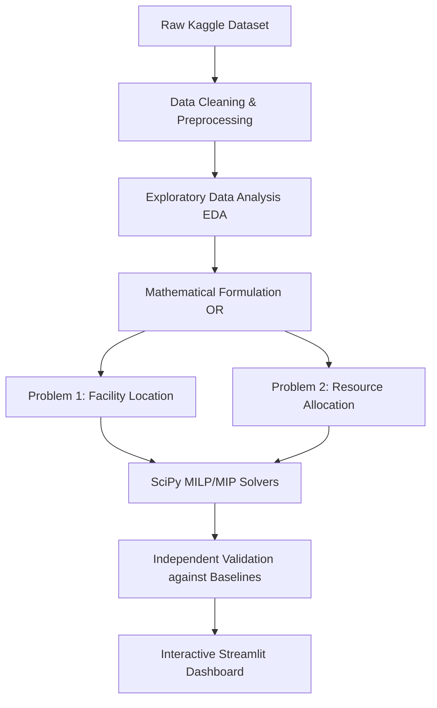

# First Review Presentation Content

Here is the updated 11-slide structure for your presentation, matching your exact requirements.

---

## Slide 1: Title
* **Title:** Strategic Optimization of EV Charging Infrastructure
* **Subtitle:** Applying Operations Research to Facility Location and Resource Allocation
* **Team Members:** [List all group members here]

## Slide 2: Introduction
* **Background:** The rapid global transition to Electric Vehicles (EVs) requires a massive scale-up in charging infrastructure.
* **The Challenge:** Building charging stations is expensive and resource-intensive. Current infrastructure is often deployed reactively rather than strategically, leading to dense clusters in some areas and "charging deserts" in others.
* **Our Approach:** By leveraging mathematical optimization and Operations Research (OR) methodologies, we can transform subjective infrastructure planning into a rigorous, data-driven decision-making process.

## Slide 3: Problem Statement
* **Core Problem:** Given a limited budget and an existing network of EV chargers, how can we expand the infrastructure to maximize both geographic coverage and regional fairness?
* **Sub-Problem 1:** Where should new high-capacity charging hubs be placed to serve the highest number of existing, isolated charging stations?
* **Sub-Problem 2:** How should a fixed number of new charging connectors be allocated across different administrative regions to ensure the most underserved areas receive adequate infrastructure?

## Slide 4: Objectives
* **Objective 1:** To mathematically model the EV charging network expansion as a set of linear and integer programming problems.
* **Objective 2:** To identify optimal locations for new hubs that maximize geographic coverage using a strict budget constraint.
* **Objective 3:** To formulate a fairness-driven allocation strategy that maximizes the minimum connectors-per-station ratio across regions.
* **Objective 4:** To build an interactive, data-driven dashboard that allows decision-makers to run these mathematical models in real-time.

## Slide 5: Dataset Description (Overview)
* **Source:** We are utilizing the "Global EV Charging Stations Dataset" sourced from Kaggle (*risheepanchal/global-ev-charging-stations-dataset*).
* **Dataset Scope:** The dataset contains detailed, real-world observational records of EV charging infrastructure globally, though our focus is on a specific subset of 10,000 stations.
* **Why this dataset?** It provides a highly realistic, point-in-time snapshot of charging infrastructure, complete with geographic coordinates, operating status, and capacity (connectors), which is essential for accurate spatial and capacity-based optimization.

## Slide 6: Dataset Description (Parameters)
* **Key Parameters Used:**
  * `lat` (Latitude): Used to calculate Haversine great-circle distances for coverage radius.
  * `lon` (Longitude): Used alongside latitude for clustering and distance metrics.
  * `state`: The regional administrative identifier, necessary for regional allocation boundaries.
  * `num_connectors`: The physical capacity of each station (number of charging ports).
  * `status`: Operational status (used to filter out non-functional stations).
* **Data Nuances:** We handle missing data programmatically; for example, records missing a `state` parameter are strictly excluded from regional optimizations to maintain mathematical integrity.

## Slide 7: Proposed Methodology

*(Suggestion for Presentation: Briefly walk through the flow. Emphasize that the translation from EDA to "Mathematical Formulation" is the core Operations Research component of the project).*

## Slide 8: Optimization Problem 1 (Hub Location)
* **What are we optimizing?** We are finding the optimal geographic placement for $K$ new charging hubs to maximize the number of existing stations that fall within their coverage radius.
* **OR Method / Topic:** **Facility Location (Maximum Coverage Problem)**
* **Formulation:** 
  * Modeled as a **Mixed-Integer Program (MIP)**.
  * We use binary decision variables ($y_j$) for selecting a hub and ($z_i$) for determining if a station is covered.
  * Subject to a strict budget constraint (sum of selected hubs $\le K$).

## Slide 9: Optimization Problem 2 (Connector Allocation)
* **What are we optimizing?** We are distributing a fixed budget of new connectors across regions to maximize the lowest (worst) Connectors-Per-Station (CPS) ratio in the network.
* **OR Method / Topic:** **Resource Allocation (Max-Min Fairness)**
* **Formulation:**
  * Modeled as a **Mixed-Integer Linear Program (MILP)**.
  * We use integer decision variables ($x_i$) for connectors given to region $i$, and a continuous auxiliary variable ($t$) representing the minimum CPS floor.
  * The objective is to maximize $t$, subject to the constraint that every region's post-allocation ratio must be $\ge t$.

## Slide 10: Tools Used
* **Data Processing & EDA:** Python, Pandas, NumPy
* **Mathematical Modeling & Optimization:** SciPy (`scipy.optimize.milp`), Scikit-Learn (Spherical K-Means for candidate generation)
* **Visualization & User Interface:** Streamlit (Web App), Plotly (Geospatial Mapping)
* **Version Control:** Git & GitHub

## Slide 11: Conclusion
* **Summary:** This project demonstrates how subjective infrastructure planning can be replaced by rigorous Operations Research models to ensure efficiency and equity.
* **Current Status:** The dataset has been analyzed, and the core mathematical programming models have been formulated and independently validated.
* **Next Steps:** Finalizing the interactive user interface, performing deep sensitivity analysis on varying budget sizes, and documenting the final findings for the final review.

---
---

# 🎓 Preparation: Potential Viva Questions

Make sure your team can answer these questions based on the slides above:

**1. Why did you choose Mixed-Integer Programming (MIP) instead of standard Linear Programming (LP)?**
> *Answer:* Standard LP allows decision variables to be continuous (fractions). For our project, we can't build 0.4 of a charging hub, or allocate 2.7 connectors. We need strict integer and binary (0 or 1) variables to represent real-world physical infrastructure, which requires MIP.

**2. What makes Optimization 1 a "Maximum Coverage" problem?**
> *Answer:* In Facility Location, there are different variations (like p-median or set covering). We chose Maximum Coverage because we have a limited budget ($K$) and cannot cover the entire map. The objective is strictly to maximize the number of covered points subject to that budget constraint.

**3. In Optimization 2, why maximize the *minimum* ratio (Max-Min) instead of just maximizing total connectors?**
> *Answer:* If we just maximized total connectors, the math might dump all resources into one dense region. Max-Min optimization is a classic Operations Research technique for *fairness*. By maximizing the floor (the region with the worst ratio), we mathematically guarantee that the most underserved areas receive resources first.
