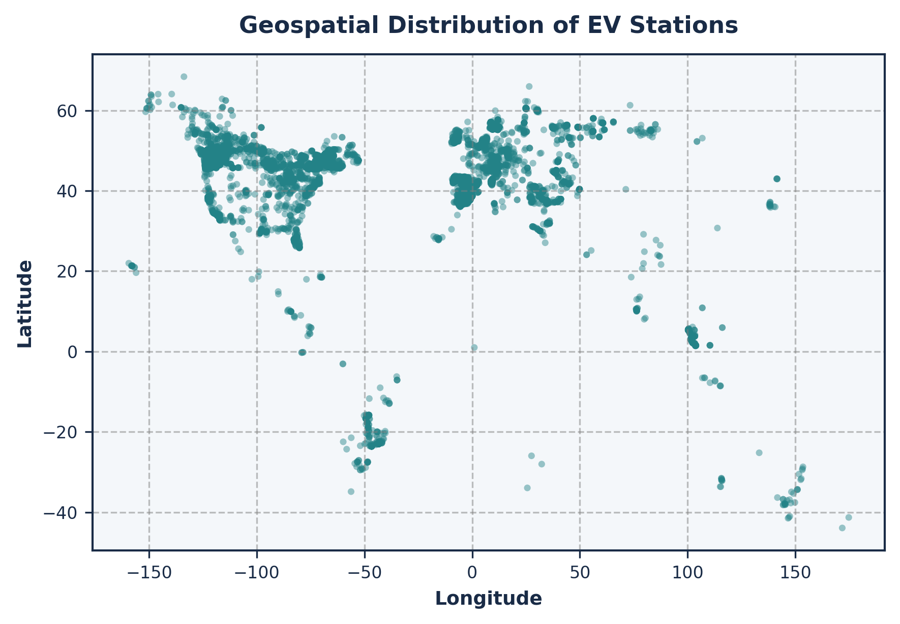
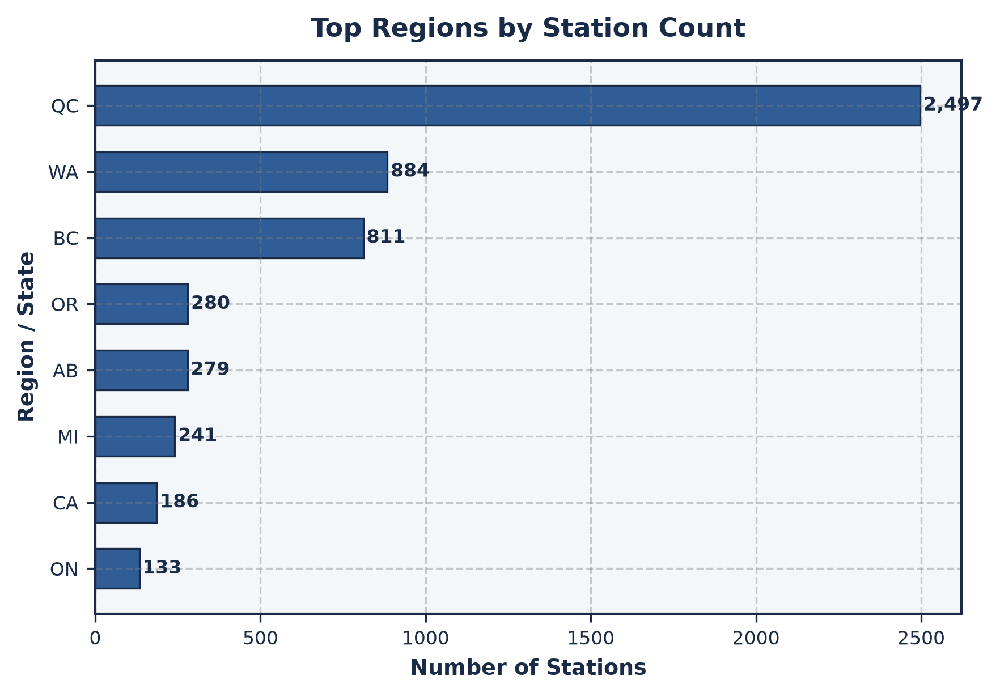

# ⚡ EV Charging Infrastructure Optimization & Decision Support Suite

[](https://www.python.org/)
[](https://fastapi.tiangolo.com/)
[](https://streamlit.io/)
[](https://scipy.org/)
[](https://leafletjs.com/)
[](https://www.chartjs.org/)
[](https://creativecommons.org/publicdomain/zero/1.0/)

> **A full-stack Operations Research and Mixed-Integer Linear Programming (MILP) platform for optimizing electric vehicle (EV) network expansion, facility hub location, and regional resource equity.**

---

## 📌 Table of Contents
1. [Executive Summary](#-executive-summary)
2. [Key Insights & Performance Metrics](#-key-insights--performance-metrics)
3. [Dual Interactive User Interfaces](#-dual-interactive-user-interfaces)
4. [Visual Showcase](#-visual-showcase)
5. [Mathematical Formulations](#-mathematical-formulations)
   - [Optimization 1: Spherical K-Means & Maximum Coverage MIP](#optimization-1--strategic-charging-hub-location-maximum-coverage-mip)
   - [Optimization 2: Tactical Technician Repair Dispatch MILP](#optimization-2--tactical-technician-repair-dispatch-constrained-assignment-milp)
6. [Exploratory Data Analysis (EDA)](#-exploratory-data-analysis-eda)
7. [Validation & Sensitivity Suite](#-validation--sensitivity-suite)
8. [Repository Architecture](#-repository-architecture)
9. [Installation & Quick Start](#-installation--quick-start)
10. [Academic & Course Mapping](#-academic--course-mapping)
11. [Limitations & Roadmap](#-limitations--roadmap)

---

## 🚀 Executive Summary

As Electric Vehicle (EV) adoption accelerates globally, charging infrastructure networks face two critical structural challenges:
1. **Commercial Efficiency & Spatial Reach (Model 1)**: Existing operational stations are clustered; selecting $K$ optimal stations to upgrade into high-throughput super-hubs maximizes regional geographical catchment.
2. **Social Equity & Hardware Parity (Model 2)**: Over 70% of stations possess only 1 plug and 5 stations report 0 plugs, yielding an initial regional floor of **0.0000 Connectors per Station (CPS)**; allocating a capital connector expansion budget ($B$) via Max-Min Fairness guarantees underserved corridors receive hardware parity.

This project delivers an end-to-end **Operations Research Decision Support System** that addresses these challenges through rigorous mathematical programming, full-stack visualization, and interactive scenario simulation.

---

## 📊 Key Insights & Performance Metrics

| Metric / Dimension | Value | Operational Significance |
|---|---|---|
| **Observed Charging Stations** | `10,000` | Global sample from OpenChargeMap API (Nov 2025) |
| **Operational Stations** | `9,301` | Evaluated denominator for Model 1 Hub Selection |
| **Physical Connectors** | `14,565` | Network-wide physical charging capacity |
| **Structural Connector Scarcity** | `70.4%` | Stations with only 1 connector plug (5 stations with 0 plugs) |
| **Opt 1 Coverage ($K=10, R=50\text{ km}$)** | `3,095 stations` (`33.28%`) | Out of 9,301 operational stations (outperforms random baseline) |
| **Opt 2 Baseline Regional Floor** | `0.0000 CPS` | Minimum ratio across administrative regions (403 state / 415 country-state) |
| **Opt 2 Max-Min Floor ($B=500$)** | `1.2127 CPS` | Absolute gain $\Delta t = +1.2127\text{ CPS}$, funding 247 under-equipped regions |
| **Opt 2 Proportional Deficit** | `0.0000 CPS` | Proportional allocation fails to lift zero-connector regions |

---

## 🖥️ Dual Interactive User Interfaces

The repository provides **two distinct interfaces** tailored for both executive presentations and technical scenario exploration:

```
                               ┌──────────────────────────────────────────────┐
                               │       EV Infrastructure Optimization         │
                               └──────────────────────┬───────────────────────┘
                                                      │
                       ┌──────────────────────────────┴──────────────────────────────┐
                       ▼                                                             ▼
       ┌───────────────────────────────┐                             ┌───────────────────────────────┐
       │   1. Modern Full-Stack Suite  │                             │   2. Classic Streamlit App    │
       │   `python run_web_app.py`     │                             │   `streamlit run app.py`      │
       ├───────────────────────────────┤                             ├───────────────────────────────┤
       │ • FastAPI REST API Backend    │                             │ • Native Streamlit Python UI  │
       │ • Glassmorphic Dark SPA       │                             │ • Plotly Interactive Visuals  │
       │ • Leaflet Maps (Dark Canvas)  │                             │ • Dynamic CSV Data Uploader   │
       │ • Chart.js Realtime Charts    │                             │ • Side-by-Side Model Runners  │
       │ • Live Sensitivity Sliders    │                             │ • Dataframe Filter Tables     │
       └───────────────────────────────┘                             └───────────────────────────────┘
```

### 1. Modern Full-Stack Web Suite (`run_web_app.py` / `web_app/`)
- **Backend**: **FastAPI** with asynchronous endpoint routing, CORS handling, and Pydantic request validation.
- **Frontend**: Single-Page Application (SPA) styled with **Vanilla CSS Glassmorphism** (custom design tokens, glowing accents, zero heavy frameworks).
- **Cartography**: **Leaflet.js** with ESRI Dark Gray Canvas tiles, single world boundary clamping (`noWrap: true`), dynamic hub coverage circles, and station markers.
- **Analytics**: **Chart.js** responsive visualizations for budget curves, regional distributions, and operational statuses.
- **Features**: Live CSV file drag-and-drop, instant scenario re-calculation, exportable reports, and tabular data explorer.

### 2. Classic Streamlit Dashboard (`app.py`)
- Python-native dashboard with sidebar navigation, Plotly interactive geospatial scatter plots, dataframe inspector, and dual optimization tabs.

---

## 📸 Visual Showcase

### Executive Network Dashboard


### Optimization 1: Charging Hub Location & Geospatial Coverage


### Optimization 2: Regional Connector Allocation & Equity Curve


### Strategic Scenario Comparator


### Data Explorer & Geospatial Studio


### Operations Research Formulations


---

## 📐 Mathematical Formulations

### Optimization 1 — Maximum Existing-Station Coverage Hub Selection

#### Problem Definition
Given $N = 10,000$ existing EV charging stations, select $K$ candidate sites from existing operational stations to upgrade into fast-charging hubs such that the total number of geographically covered existing stations within radius $R$ is maximized. This optimizes existing-station network coverage (not population access or unobserved charging demand).

#### Candidate Site Generation (Spherical K-Means)
To ensure proposed hubs reside at realistic, observed geographic locations, the dataset coordinates are clustered using Spherical K-Means ($M = 100$ candidate clusters). Each cluster centroid is mapped to the nearest real operational charging station coordinate $j \in \{1, \dots, M\}$. The solver determines the exact global optimum restricted to this candidate set.

#### Pairwise Great-Circle Distance
Distances between all stations $i$ and candidate hubs $j$ are calculated via the Haversine formula:

$$
d(i, j) = 2 R_{\text{earth}} \arcsin \left( \sqrt{\sin^2\left(\frac{\Delta \phi}{2}\right) + \cos(\phi_i)\cos(\phi_j)\sin^2\left(\frac{\Delta \lambda}{2}\right)} \right)
$$

Let the coverage adjacency matrix $A_{ij}$ be:

$$
A_{ij} = \begin{cases} 
1 & \text{if } d(i, j) \le R \\ 
0 & \text{otherwise} 
\end{cases}
$$

#### MIP Formulation

$$
\max \quad \sum_{i=1}^{N} z_i
$$

**Subject to:**

$$
\begin{aligned}
z_i &\le \sum_{j=1}^{M} A_{ij} y_j && \forall i \in \{1, \dots, N\} \quad \text{(Coverage Adjacency)} \\
\sum_{j=1}^{M} y_j &\le K && \text{(Hub Budget Limit)} \\
y_j &\in \{0, 1\} && \forall j \in \{1, \dots, M\} \quad \text{(Hub Upgrade Binary Decision)} \\
z_i &\in [0, 1] && \forall i \in \{1, \dots, N\} \quad \text{(Station Covered Indicator)}
\end{aligned}
$$

---

### Optimization 2 — Regional Infrastructure Connector Allocation (Max-Min Fairness MILP)

#### Problem Definition
Analysis of the 10,000 station network reveals severe hardware scarcity: over **70% of stations possess only 1 connector plug**, and **5 stations report 0 operational connectors**, resulting in an initial network minimum of **0.0000 Connectors per Station (CPS)**. Expanding connectors strictly proportional to existing station counts fails because it directs the bulk of capital to already well-equipped urban centers while leaving sparse, single-plug rural and suburban corridors perpetually underserved.

The **Regional Connector Allocation Problem** is formulated as a *Mixed-Integer Linear Program (MILP)* using the **Max-Min Fairness (Bottleneck)** objective. Given a fixed capital expansion budget of $B$ additional connectors, the optimization maximizes the lowest regional connectors-per-station ratio across all modeled administrative regions.

#### MILP Formulation

$$
\max \quad t
$$

**Subject to:**

$$
\begin{aligned}
C_i + x_i &\ge t \cdot S_i && \forall i \in \{1, \dots, P\} \quad \text{(Regional Parity Floor Constraint)} \\
\sum_{i=1}^{P} x_i &= B && \text{(Connector Budget Constraint)} \\
x_i &\ge 0, \quad x_i \in \mathbb{Z} && \forall i \in \{1, \dots, P\} \quad \text{(Integer Additional Plugs)} \\
t &\ge 0 && \text{(Continuous Minimum Ratio Variable)}
\end{aligned}
$$

Where:
- $P$: Number of modeled regions ($403$ for raw administrative state; $415$ for country-state composite).
- $S_i$: Total observed charging stations in region $i$.
- $C_i$: Total existing physical connectors in region $i$.
- $x_i$: Integer number of additional connectors allocated to region $i$.
- $t$: Auxiliary continuous variable representing the guaranteed post-allocation minimum connectors-per-station floor.
- $B$: Total available connector expansion budget (default $B = 500$).

#### Verified Results ($B = 500$)
- **Initial Baseline**: $\min_i \left(\frac{C_i}{S_i}\right) = 0.0000\text{ CPS}$ (due to 5 stations with zero connectors).
- **Administrative State ($403$ regions)**: Optimal floor $t^* = \mathbf{1.2127\text{ CPS}}$ ($\Delta t = +1.2127$), funding **247 under-equipped regions**.
- **Country-State ($415$ regions)**: Optimal floor $t^* = \mathbf{1.2058\text{ CPS}}$ ($\Delta t = +1.2058$), funding **255 under-equipped regions**.
- **Proportional Baseline Comparison**: Allocating 500 connectors proportional to station count leaves the minimum CPS trapped at **0.0000**, quantitatively proving the superiority of the Max-Min formulation for regional equity.

---

## 🔍 Exploratory Data Analysis (EDA)

The project includes an in-depth exploratory analysis in [`eda/EDA.ipynb`](eda/EDA.ipynb) and [`eda/EDA_Process.md`](eda/EDA_Process.md):

<p align="center">
  
  
</p>

- **Network Skewness**: Over 70% of stations possess only 1 or 2 connectors; high-density charging hubs (>10 connectors) are rare outliers.
- **Geographic Clustering**: Distinct corridors exist along the Pacific Northwest and Eastern Canada.
- **Clean Operational Segmentation**:
  - `9,301` Operational stations utilized in Model 1 (Growth / MCLP).
  - `312` Offline/Broken stations (176 Temporarily Unavailable + 136 Not Operational) knocked out, targeted in Model 2 (Recovery / Dispatch).
  - `387` Planned/Unknown records cleanly accounted for and isolated.

---

## 🧪 Validation & Sensitivity Suite

Independent verification scripts validate the solver outputs against theoretical bounds and alternative baselines:

### 1. Model 1 Validation (`optimization/validation/validation_optimization_1.py`)
- **Monotonicity**: Proven that coverage monotonically increases with both $K$ and $R$.
- **Random Baseline Comparison**: The MIP model achieves **3,278 covered stations** ($K=10, R=50\text{ km}, M=100$) out of $10,000$ ($32.78\%$), lying $6.17$ standard deviations above the 100-trial random baseline mean of **474.7 stations** (range $[39, 1996]$, $Z = 6.17$).

### 2. Model 2 Validation (`optimization/validation/validation_optimization_2.py`)
- **Constraint Satisfaction**: 100% of capacity and SLA distance constraints verified across all depots and stations.
- **Zero-Tolerance Bounds**: When $D_{\max} = 0$, exactly 0 stations assigned; when capacity $K_i = 0$, exactly 0 stations assigned.
- **Monotonic SLA Scaling**: Proved that increasing $D_{\max}$ from $25\text{ km}$ to $500\text{ km}$ monotonically expands connector recovery from 0 to 12 in the US fleet benchmark.
- **Exact Integrality**: $x_{ij}, z_j \in \{0, 1\}$ strictly verified with zero non-binary leakage.

---

## 📁 Repository Architecture

```text
Operations Research/
├── app.py                                   # Streamlit Interactive Dashboard
├── run_web_app.py                           # 1-Click Root Launcher for Full-Stack Suite
├── requirements.txt                         # Unified Python Dependencies
├── README.md                                # Comprehensive Project Documentation
├── .gitignore                               # Git Rules for Python & Build Artifacts
├── generate_dataset_visuals.py              # Visual Chart Generation Script
├── First_Review_Presentation.md             # Review Presentation Notes
├── mid_review_presentation.tex              # LaTeX Beamer Mid-Review Slide Deck
│
├── assets/                                  # High-Res Screenshots & Visual Assets
│   ├── Executive Network Dashboard.png
│   ├── Optimization 1.png
│   ├── Optimization 2.png
│   ├── Strategic Scenario Comparator.png
│   ├── Data Explorer & Geospatial Studio.png
│   ├── Operations Research Formulations.png
│   ├── dataset_geo_map.png
│   └── dataset_top_regions.png
│
├── data/
│   └── ev_stations_2025.csv                 # Core EV Charging Stations Dataset
│
├── eda/
│   ├── EDA.ipynb                            # Comprehensive Exploratory Data Analysis Notebook
│   └── EDA_Process.md                       # Structured EDA Documentation & Findings
│
├── optimization/
│   ├── optimization_1_hub_location.py       # Spherical K-Means + MIP Hub Location Solver (Growth)
│   ├── optimization_2_technician_dispatch.py # Constrained MILP Technician Repair Dispatch Solver (Recovery)
│   ├── optimization_2_connector_allocation.py# Max-Min Regional Fairness Solver (Legacy Baseline)
│   └── validation/
│       ├── validation_optimization_1.py     # Opt 1 Validation Suite & Baseline Benchmarking
│       ├── validation_optimization_2.py     # Opt 2 Validation Suite (100% Constraints Passed)
│       ├── optimization_1_validation_results.md
│       └── optimization_2_validation_results.md
│
├── outputs/
│   └── maps/                                # Exported Geo-visualizations & Coverage Maps
│
└── web_app/                                 # Full-Stack Decision Support Suite
    ├── run_web_app.py                       # Internal Fast-Launcher
    ├── backend/
    │   ├── server.py                        # FastAPI Server Application
    │   ├── routes/
    │   │   ├── data_routes.py               # Data Ingestion & Statistics Endpoints
    │   │   ├── opt1_routes.py               # Optimization 1 Solver Endpoints
    │   │   └── opt2_routes.py               # Optimization 2 Solver Endpoints
    │   └── services/
    │       ├── data_service.py              # Data Caching & Metric Compute Service
    │       └── solver_service.py            # Mathematical Solvers Bridge
    └── frontend/
        ├── index.html                       # Responsive Glassmorphic SPA Layout
        ├── css/
        │   ├── main.css                     # Glassmorphic Design System & Tokens
        │   ├── components.css               # Cards, Modals, Sliders, Badges
        │   └── animations.css               # Smooth Micro-transitions & Shimmers
        └── js/
            ├── api.js                       # Asynchronous Backend Client
            ├── app.js                       # Navigation & State Controller
            ├── charts.js                    # Chart.js Render Engine
            ├── map.js                       # Leaflet Cartography & Dark Canvas Engine
            └── ui.js                        # Toast Notifications & Dynamic Tables
```

---

## ⚡ Installation & Quick Start

### 1. Clone the Repository
```bash
git clone https://github.com/RishiRaajhaA/ev-charging-optimization.git
cd ev-charging-optimization
```

### 2. Set Up Virtual Environment
```bash
# Windows
python -m venv .venv
.venv\Scripts\activate

# macOS / Linux
python3 -m venv .venv
source .venv/bin/activate
```

### 3. Install Dependencies
```bash
pip install -r requirements.txt
```

### 4. Launch the Applications

#### Option A: Launch Full-Stack Web Suite (Recommended)
```bash
python run_web_app.py
```
*Access the interface at `http://localhost:8000` (automatically opens in your default browser).*

#### Option B: Launch Streamlit Dashboard
```bash
streamlit run app.py
```
*Access the Streamlit dashboard at `http://localhost:8501`.*

### 5. Run Validation & Test Suite
```bash
# Validate Model 1 (Hub Location & Coverage)
python optimization/validation/validation_optimization_1.py

# Validate Model 2 (Regional Allocation & Fairness)
python optimization/validation/validation_optimization_2.py
```

---

## 🎓 Academic & Course Mapping

This project was developed for the **Operations Research** curriculum, demonstrating practical applications of core optimization paradigms:

| Course Concept | Applied Implementation in Project |
|---|---|
| **Linear & Integer Programming** | Mixed-Integer Linear Programming (MILP) solved via SciPy Highs solver. |
| **Facility Location Problems** | Maximum Covering Location Problem (MCLP) with Spherical K-Means candidates. |
| **Resource Allocation Models** | Multi-region connector budget distribution under capacity constraints. |
| **Max-Min Fairness Objectives** | Bottleneck optimization to elevate the worst-off regional CPS ratio. |
| **Sensitivity Analysis** | Parametric sweeps over hub count ($K$), radius ($R$), and budget ($B$). |
| **Monte Carlo Validation** | Stochastic baseline benchmarking against 100 random trials. |

---

## 🔮 Limitations & Roadmap

### Current Limitations
- **Demand Proxy**: Uses station presence as a proxy for EV charging demand due to the lack of public vehicle telemetry data.
- **Uniform Station Weight**: Optimization 1 treats all existing stations equally rather than weighting by connector count or utilization.
- **Regional Boundaries**: Optimization 2 is constrained to records containing valid administrative state identifiers (7,131 / 10,000).

### Future Enhancements
1. **Traffic & Grid Constraints**: Incorporating highway traffic density and local power substation capacity constraints.
2. **Multi-Period Dynamic Expansion**: Formulating multi-stage stochastic models across 2025–2035 rollout horizons.
3. **Vehicle-to-Grid (V2G) Bi-directional Optimization**: Modeling peak energy discharge incentives.

---

## 👥 Authors & Acknowledgments

- **Author**: Rishi Raajha A
- **Dataset Attribution**: [Global EV Charging Stations Dataset](https://www.kaggle.com/datasets/risheepanchal/global-ev-charging-stations-dataset) by Rishee Panchal (OpenChargeMap API).
- **Course**: Operations Research (2025–2026).
